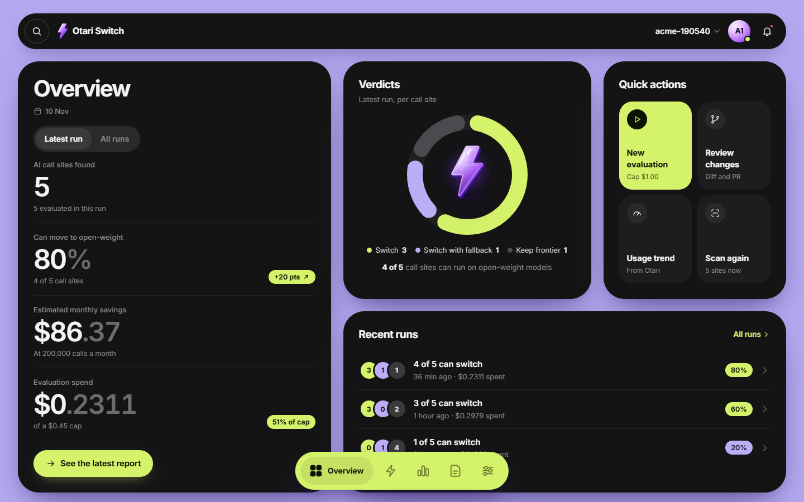
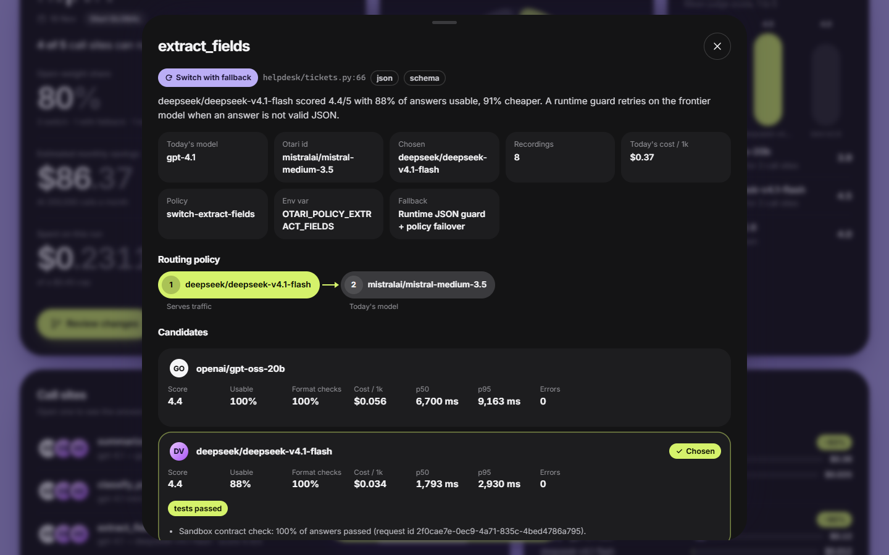
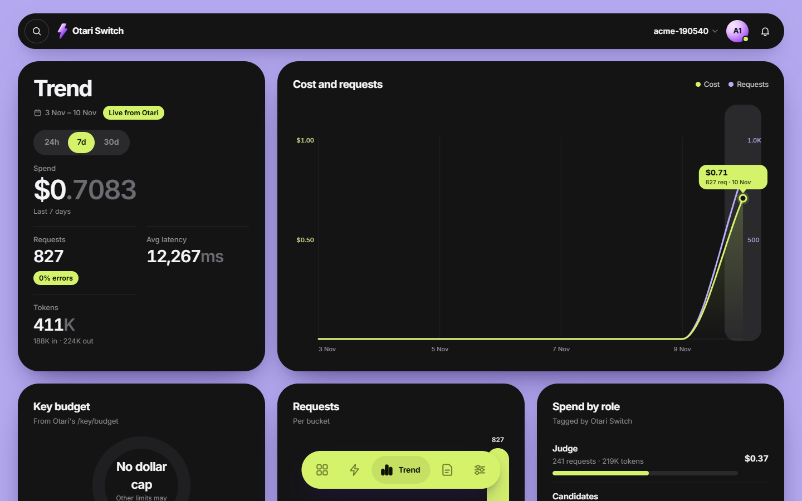
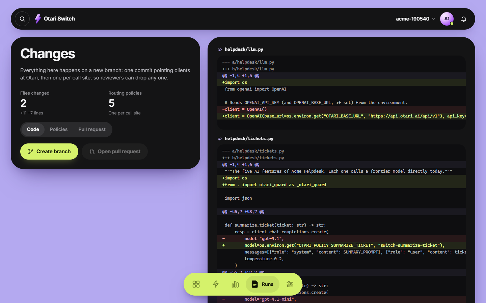

# Otari Switch

[](https://github.com/XSTRANGER-7/otari-switch/actions/workflows/tests.yml)  

**Move your app's AI calls from frontier APIs to open-weight models through [Otari](https://github.com/mozilla-ai/otari), one call site at a time, and prove each move is safe before the pull request.**

Point it at a repo. It finds every OpenAI and Anthropic SDK call, records what those calls really send, replays them on open-weight models through Otari, and judges the answers. You get a "can you switch?" verdict per call site, and a pull request that routes each call through an Otari routing policy, with today's model kept as the fallback wherever open models fall short.

A real run on hosted [otari.ai](https://otari.ai) (Nov 10, 2026), on the bundled sample helpdesk app:

```
• Replaying prompts on open-weight models
  ✓ Switch                summarize_ticket   → openai/gpt-oss-20b            4.8/5, 93% cheaper
  ✓ Switch                classify_priority  → deepseek/deepseek-v4.1-flash  5.0/5, 90% cheaper
  ↻ Switch with fallback  extract_fields     → deepseek/deepseek-v4.1-flash  4.4/5, 91% cheaper (+ runtime JSON guard)
  ✓ Switch                draft_reply        → openai/gpt-oss-20b            5.0/5, 95% cheaper
  – Keep frontier         choose_action        best open model 3.1/5 on picking the right tool
• Running your tests on the chosen models: passed
• Contract checks in Otari's sandbox: 100% of JSON answers valid

4 of 5 calls can switch · 80% open-weight · tests passed
  Estimated savings: $86.37 a month (at 200,000 calls)
  Spent $0.2311 of $0.45
```

The app's own tests recorded 40 real prompts through Otari. Today's model was `mistralai/mistral-medium-3.5`, standing in for `gpt-4.1`, which that org's catalog doesn't serve. Every score links to an `Otari-Request-ID` you can open in the Otari dashboard. Details are in [Proof: real runs](#proof-real-runs).

**Demo video (3:31):** [`site/media/demo.mp4`](site/media/demo.mp4) walks through every step. The live-evaluation scene uses the local demo gateway and says so on screen; everything else is the real otari.ai run above. Voice-over script: [docs/DEMO_SCRIPT.md](docs/DEMO_SCRIPT.md).

<p>




</p>

## For judges: see it in 5 minutes

| How | What you need | What you see |
| --- | --- | --- |
| **Watch** | nothing | The [demo video](site/media/demo.mp4) (3:31), the screenshots above, and [Proof: real runs](#proof-real-runs) with real otari.ai numbers |
| **Try it on your laptop** | Python 3.10+ and git | The full flow on a sample app with a local demo gateway: no key, no cost, about 2 minutes (steps below) |
| **Run it for real** | An [otari.ai](https://otari.ai) key | Your own repo (or the sample app) evaluated on real open-weight models, with a hard spend cap |

The app is a local developer tool by design: it runs on `127.0.0.1` and reads your code and your keys, so there is no shared hosted copy of it. The product site in `site/` is static.

## Run it on your laptop

These are the exact steps checked on a fresh clone (Windows 11, Python 3.14) on Nov 11, 2026: install, demo (4 of 5 switch, tests passed) and all 55 tests.

**1. Get the code and install it** (a virtual environment keeps your Python clean):

Windows (PowerShell):
```powershell
git clone https://github.com/XSTRANGER-7/otari-switch
cd otari-switch
python -m venv .venv
.venv\Scripts\Activate.ps1
pip install -e ".[dev]" openai
```

macOS / Linux:
```bash
git clone https://github.com/XSTRANGER-7/otari-switch
cd otari-switch
python3 -m venv .venv
source .venv/bin/activate
pip install -e ".[dev]" openai
```

`openai` is only for the sample app's own tests, so the test gate can run. If PowerShell refuses to run `Activate.ps1`, run `Set-ExecutionPolicy -Scope Process Bypass` first.

**2. Try the demo (no key, no cost).** Run it from any empty folder, because it creates `./otari-switch-demo` there:

```bash
otari-switch demo            # the app opens in your browser at http://127.0.0.1:4317
otari-switch demo --cli      # or the same flow in the terminal
```

In the app, click through the dock: **Switch flow → Connect → Scan → Record → Models → Evaluate → Report** (open a call site), then **Changes → Create branch**. The Evaluate screen shows the live run, and every screen with demo data carries a "Demo gateway" badge.

What you should see: `4 of 5 calls can switch · 80% open-weight · tests passed`, about $0.01 spent of a $1.00 cap, and a git branch with 7 commits inside `otari-switch-demo`.

**3. Run the tests** (offline, about 2 minutes): `pytest`. Expect `55 passed`.

**4. Run it for real** on the sample app or your own repo, with your otari.ai key (details in [Use it on your repo](#use-it-on-your-repo)):

```bash
export OTARI_API_KEY=otk_...          # PowerShell: $env:OTARI_API_KEY = "otk_..."
cd path/to/your-repo                  # a git repo with no uncommitted changes
otari-switch init --yes               # reads your catalog, picks open models and a judge
otari-switch doctor                   # every line ✓ or –
otari-switch record --via-otari       # your tests, every call through Otari
otari-switch eval --budget 0.5        # hard spend cap
otari-switch ui                       # see the run in the app
```

If your org's catalog does not serve your app's current model (for example `gpt-4.1`), record on one it does: `otari-switch record --as mistralai/mistral-medium-3.5`.

**Troubleshooting**

| Problem | Fix |
| --- | --- |
| `otari-switch` is not found | Activate the virtual environment, or use `python -m otari_switch ...` |
| `Repo tests not run: the openai/anthropic package is not installed` | `pip install openai` (or `anthropic`) in the same environment |
| `exists and is not an Otari Switch demo folder` | Run `otari-switch demo` from an empty folder |
| `You have uncommitted changes in ...` on Create branch | Commit or stash your work first; Otari Switch only writes to a new branch |
| `budget reached` | Raise `--budget` (or Settings → budget); nothing past the cap is ever sent |
| Port 4317 is busy | The app picks the next free port and prints it; or `otari-switch ui --port 4400` |

## Who it is for

| You | Your problem | What you get |
| --- | --- | --- |
| A developer with AI features in production | You want lower cost or less lock-in, but fear a quality drop | Evidence per call site, then a reviewed PR |
| A platform or engineering lead | Many repos call providers directly, with no central control of spend | One gateway, budgets per team, a migration report per repo |
| The Otari team | People try Otari, then call the provider directly again | A paved road from "direct provider" to "Otari with open models" |

## Use it on your repo

```bash
cd your-repo
export OTARI_API_KEY=otk_...        # otari.ai key (EU workspaces: --region eu); a self-hosted gateway's key starts tk-
otari-switch init                   # tests the key, reads Otari's catalog, suggests 3 open-weight candidates + a judge
otari-switch ui                     # the app: scan → record → choose models → evaluate → report → PR
# or the same in the terminal:
otari-switch run                    # stops for a yes before writing anything
```

The key can also live in a `.env` file in the repo or the current folder (`OTARI_API_KEY=otk_...`; only `OTARI_*` names are read, a variable already set wins). Keep `.env` out of git.

No direct OpenAI or Anthropic key? Record through Otari: `otari-switch record --via-otari` runs your tests with each call sent to Otari on today's model (`gpt-4.1` becomes `openai/gpt-4.1`). On a gateway that doesn't serve today's model (a local one, say), `otari-switch record --as <model>` records on that model and saves it under `eval.today_models`, so the evaluation compares against the same model.

**Before the first run, in the Otari dashboard:**
1. Turn on **Tools → Code execution** (and give it a price) so contract checks can run in Otari's sandbox. Without it the run still works; the report says the sandbox step was skipped.
2. Pick 2 or 3 open-weight models and one judge, or let `init` / the app suggest them from your catalog (`GET /models`: catalog ids such as `meta-llama/llama-3.3-70b-instruct`, with prices and supported parameters).
3. Optional: add **GitHub's MCP server** under Tools → MCP servers, give your key access, and put its id in `otari-switch.yml` (`github.mcp_server_id`). The PR is then opened through Otari's caller-orchestrated MCP (`/mcp/servers/{id}/tools`, then one `POST /mcp/execute` of `create_pull_request`), so the GitHub token stays in Otari. Without it, the `gh` CLI is used.
4. Optional: a guardrail profile for personal data, then set `privacy.use_otari_guardrail: true` and `privacy.guardrail_profile: <name>`.

**Self-hosted Otari** works the same: `--region http://localhost:8000/api/v1`. With the operator key in `OTARI_MASTER_KEY` and `otari.policies_api: true`, `apply` creates the routing policies through `POST /api/v1/routing/policies` (each checked with `/routing/policies/explain` first); it also writes `.otari-switch/otari-routing.yml` to paste into `config.yml`.

`otari-switch doctor` checks all of this and says how to fix anything missing.

## How it works

1. **Scan.** Parses every `.py` file with `ast` (code never runs) and finds `chat.completions.create`, `responses.create` and `messages.create` calls, with their model, JSON format, tools and streaming flags.
2. **Record.** Runs your tests (or a script, or imports logs) with a thin wrapper around the OpenAI and Anthropic SDKs. Calls go to your current provider as usual; the wrapper only saves request and answer per call site (default 20, deduplicated) to `.otari-switch/recordings.jsonl`, which is git-ignored.
3. **Privacy check.** Emails, API keys, card numbers (Luhn-checked) and phone numbers are replaced with consistent placeholders before anything is replayed.
4. **Replay.** Each recording goes to each candidate through Otari, with only `model` changed. Every request carries `Otari-Tags` (`tool=otari-switch`, `role=candidate|judge|frontier|sandbox`) and an `Idempotency-Key`, so retries are never billed twice and spend shows up per role in Otari's usage. A preflight catches models that reject a parameter your app sends (Otari answers `400 unsupported_parameter`, for example for `response_format`); those models are reported and never chosen for that call. Today's model is called through Otari too (`gpt-4.1` becomes the catalog id `openai/gpt-4.1`), so savings compare real `usage.cost_usd` numbers.
5. **Judge.** Exact checks first: valid JSON, JSON schema, tool name and arguments, short labels. Free text goes to an LLM judge (temperature 0, answer order randomised) that scores 1 to 5 against today's answer. A judge that reasons first gets `reasoning_effort: "low"` and one retry with more room if its thinking used up the reply (seen live on otari.ai).
6. **Test gate.** Your test suite runs again with every call going through Otari: switched call sites on their chosen open model (with the same JSON guard the PR adds), the rest on today's model. If it fails, a baseline run on today's models tells "the switch broke it" from "it was already failing", then failing call sites are found one by one. JSON contract checks also run in Otari's sandbox (`POST /code/execute`).
7. **Verdict.** The cheapest candidate that clears the bar wins. A candidate more than 4× slower than today's model (median latency on the same prompts) or more expensive than today's model is not chosen; both guards are thresholds you can change:

   | Verdict | Default rule (editable in Settings or `thresholds:`) |
   | --- | --- |
   | Switch | mean ≥ 4.0, ≥ 90% of answers score 3+, every format check passes, tests pass |
   | Switch with fallback | mean ≥ 3.5, ≥ 85% of answers pass format checks, tests pass. JSON call sites get a runtime guard that retries once on today's model if an answer is not valid JSON |
   | Keep frontier | anything else; the call still moves to Otari on the same model, so it gains budgets and traces |

8. **Apply.** One Otari routing policy per call site, in Otari's own shape: `{"name": "switch-<function>", "spec": {"select": [{"default": "<chosen open model>"}], "on_failure": ["<backup open model>", "<today's model>"]}}`. On otari.ai, policies are created in the dashboard (the API needs operator authority), so `apply` writes exact steps to `.otari-switch/POLICIES.md`. A new branch gets one commit pointing clients at Otari, then one commit per call site, so reviewers can drop any one. Model strings become `os.environ.get("OTARI_POLICY_X", "switch-x")`.
9. **Rollback** needs no code change: move today's model to the top of the policy in the Otari dashboard.

## How Otari is used

Every row is used by the running application, not just switched on in a dashboard.

| Otari feature | What it does in Otari Switch | Code |
| --- | --- | --- |
| **Open-weight models, distinct roles** | Open-weight candidates replace frontier calls; a separate open-weight judge scores them; today's model is the reference and fallback | `evaluate.py`, `judge.py` |
| **Model routing and fallbacks** | The product's output: one Otari routing policy per call site (open model first, today's model as fallback), or a **weighted canary** (`apply --canary 20`: 20% of traffic on the open model); created through `POST /routing/policies` after `/routing/policies/explain`, or as exact dashboard steps; `Otari-Fallback` and `Otari-Attempt-Count` recorded per answer | `policies.py` |
| **Web fetch** | **Licence check:** each candidate's official model card is read through `POST /fetch` and its `license:` line classified (open / restricted / unverified), because the catalog has no licence field; shown in the app and the report, metered and tagged `role=license` | `licenses.py` |
| **Code execution** | JSON contract checks in Otari's sandbox (`POST /code/execute`) | `testgate.py` |
| **Budgets and spending limits** | A hard cap on every evaluation, checked before each call; Otari's `403 budget_exceeded` stops a run cleanly; `/key/budget` and `/key/usage/summary` feed the Trend screen | `otari_client.py`, `server.py` |
| **Per-user budgets** | **Team mode:** with an Otari service key, each teammate's runs (replay, judge, recording and test gate) are billed to their own end user (`user` field, `Otari-End-User-Budget`), the evaluation cap shrinks to what that teammate's budget allows, and a refusal names the teammate; spend per teammate in Trend | `pipeline.py` (`budget_cap`), `record/override.py` |
| **Guardrails** | A guardrail profile in `block` mode screens recorded prompts before replay; blocked ones are skipped, and counts plus request ids land in the report | `evaluate.py` |
| **MCP** | GitHub's MCP server stored in Otari opens the PR (`/mcp/servers/{id}/tools`, then one `POST /mcp/execute`, never retried); Otari Switch also ships its own MCP server for coding agents | `pr.py`, `mcp_server.py` |
| **Request ids, tags, idempotency** | Every score links to its `Otari-Request-ID`; spend is tagged by role with `Otari-Tags`; retries reuse one `Idempotency-Key` | `otari_client.py` |

Read on every call: `Otari-Request-ID`, `Otari-Provider`, `Otari-Model`, `Otari-Fallback`, `Otari-Attempt-Count`, `Otari-Response-Duration-Ms`, `Otari-Guardrails`, and `usage.cost_usd` (a decimal string) with `usage.pricing_source`. Errors are read from `Otari-Error-Code` and the `{"detail", "code"}` body (Anthropic's envelope on `/messages`): `budget_exceeded` (403, with `Otari-Budget-Scope` and `Retry-After`) stops the run cleanly, `x-should-retry: false` is respected, and a key sent to the wrong region (421) gets a clear fix.

## Commands

| Command | Does |
| --- | --- |
| `otari-switch init` | Writes `otari-switch.yml`, tests the key, adds `.otari-switch/` to `.gitignore` |
| `otari-switch doctor` | Checks Python, key, region, models, judge, key budget, web fetch, code execution, team mode, guardrail profile, SDKs, git, MCP server |
| `otari-switch licenses [MODEL ...] [--refresh]` | Reads model cards through Otari's web fetch and reports each licence |
| `otari-switch scan [--json]` | Lists AI call sites |
| `otari-switch record [--tests CMD \| --script FILE \| --import LOG] [--via-otari] [--as MODEL]` | Captures prompts (directly, or through Otari) |
| `otari-switch eval [--budget 2] [--sites id1,id2]` | Privacy check, replay, judge, test gate, verdicts |
| `otari-switch report [--open]` | Writes `report.html` and `report.md` |
| `otari-switch apply [--dry-run] [--yes] [--no-git] [--canary PCT]` | Creates policies (full switch, or a weighted canary) and rewrites code on a new branch |
| `otari-switch pr` | Pushes the branch and opens the PR |
| `otari-switch run` | All of the above, stopping before `apply` for a yes |
| `otari-switch ui` | The app at `http://127.0.0.1:4317` |
| `otari-switch demo [--cli]` | Sample repo and fake gateway |
| `otari-switch mcp` | MCP server for coding agents (`pip install -e ".[mcp]"`) |

Exit codes: 0 success, 1 user error (with a fix message), 2 budget reached, 3 Otari unreachable. Use `-C path` to point at another folder.

## Configuration: `otari-switch.yml`

```yaml
otari:
  base_url: https://api.otari.ai/api/v1   # EU: https://eu.api.otari.ai/api/v1; self-hosted: http://localhost:8000/api/v1
  api_key_env: OTARI_API_KEY             # the key itself never goes in this file
  policies_api: false                    # true on a self-hosted gateway to create policies with the operator key
  master_key_env: OTARI_MASTER_KEY       # read only when policies_api is true
  workspace_id: ""                       # optional workspace for API-created policies
  end_user: ""                           # team mode (service key): bill this teammate's own Otari budget
  end_user_budget: ""                    # optional budget id a new teammate starts on
eval:
  budget_usd: 2.0
  recordings_per_site: 20
  concurrency: 4
  judge_model: <judge id from your catalog>
  candidates: [<open model 1>, <open model 2>, <open model 3>]
  monthly_calls: 100000                  # for the savings estimate
  license_check: true                    # read candidates' model cards through Otari's web fetch
thresholds: {switch_mean: 4.0, switch_min_share: 0.9, fallback_mean: 3.5, fallback_check_rate: 0.85,
             max_latency_ratio: 4.0, max_cost_ratio: 1.0}   # 0 turns a guard off
privacy: {mode: mask, use_otari_guardrail: false, guardrail_profile: ""}   # mode: mask | skip | off
tests: {command: "pytest -q", run_local: true, sandbox_checks: true}
github: {mcp_server_id: "", base_branch: main}
sites:
  app/summarize.py:summarize:0: {candidates: [<open model 1>], exclude: false}
```

When `policies_api` is false, `apply` writes `.otari-switch/POLICIES.md` with exact dashboard steps and the API body for each policy, plus `.otari-switch/otari-routing.yml` for a self-hosted `config.yml`.

## GitHub Action

```yaml
# .github/workflows/otari-switch.yml
on: { workflow_dispatch: {} }
jobs:
  switch:
    runs-on: ubuntu-latest
    permissions: { contents: write, pull-requests: write }
    steps:
      - uses: actions/checkout@v4
      - uses: XSTRANGER-7/otari-switch@main
        with:
          otari-api-key: ${{ secrets.OTARI_API_KEY }}
          budget-usd: "2"
          mode: report        # or: pr
```

## MCP server for coding agents

```json
{ "mcpServers": { "otari-switch": { "command": "otari-switch", "args": ["-C", "/path/to/repo", "mcp"] } } }
```

Tools: `scan_repo`, `record_prompts`, `evaluate`, `get_report`, `apply_switch`. `apply_switch` is a dry run unless the agent passes `dry_run: false`, which its description tells it to do only after the user says yes.

## Safety

- Nothing is written to your code without a diff and a yes (CLI) or a button press (app), and only on a new branch.
- The key is read from an environment variable and never written to disk. The app keeps a pasted key in memory only.
- The app listens on 127.0.0.1 only, rejects other `Host` headers, and needs a per-session token on every API call.
- Every evaluation has a hard spend cap; the meter stops before the next call would pass it.
- Recordings stay in `.otari-switch/`, which is added to `.gitignore`.
- Rewritten files are compiled before they are written.
- Honest results: "Keep frontier" is a normal outcome and the report says why.

## Develop

```bash
pip install -e ".[dev]"
pytest                      # 74 tests, offline: scanner, judge, verdicts, privacy, the Otari API contract
                            # (costs, tags, errors, retries, sandbox, policies, MCP), rewrite, recorder, server
                            # auth, and a full end-to-end run on the demo repo against the demo gateway
```

Layout: `src/otari_switch/` holds the engine (one module per step), `server.py` plus `web/` (the app, no build step), `fake_otari.py` (the demo gateway), `demo/` (the sample repo) and `mcp_server.py`.

**Dependencies:** Python 3.10+ and PyYAML. Everything else is the standard library. The app is plain HTML, CSS and JavaScript, with no Node or build step needed.

## Proof: real runs

Everything below ran on Nov 10, 2026 against real Otari gateways, on a copy of the bundled sample helpdesk app.

**Hosted otari.ai** (a personal key, catalog of 165 models, 110 of them open-weight chat models):

1. `init --yes` read the catalog and picked `openai/gpt-oss-20b`, `deepseek/deepseek-v4.1-flash` and `moonshotai/kimi-k2.6` (all three confirm JSON and tool support), with `alibaba/qwen3.6-27b` as judge.
2. `record --as mistralai/mistral-medium-3.5` ran the app's 40 tests with every call through Otari: 40 real prompts in 65 s.
3. The first `eval` exposed three real problems the demo gateway could not:
   - The reasoning judge spent its whole reply budget thinking and returned empty content.
   - A 30-second model left an `Idempotency-Key` "in progress" after our client timed out.
   - A slower, pricier candidate could still win a call site.

   All three are fixed and pinned by tests. The third run gave the result at the top of this page.
4. Otari's own usage API (`GET /key/usage/summary?group_by_tag=role`) reports, for all three runs together, $0.71 over 827 requests. By role: judge $0.37, candidates $0.19, test gate $0.07, today's model $0.03, recording $0.03. The judge is the biggest cost, so a non-reasoning judge makes runs cheaper.
5. The sandbox contract check ran on otari.ai: `POST /code/execute`, 100% of JSON answers valid.

**Self-hosted Otari** (`mozilla-ai/otari` main @ 6c54933 from source, SQLite, three llama.cpp CPU models on a laptop):

1. `today`: `qwen2.5-1.5b-instruct`; candidates: `llama-3.2-1b-instruct` and `qwen2.5-0.5b-instruct`; judge: the 1.5B model.
2. Result: 3 of 5 call sites switch, $0.017 of a $0.50 cap at the local prices.
3. `apply` created the 5 routing policies through `POST /api/v1/routing/policies` with the operator key. Calling `model: "switch-summarize-ticket"` was then served by `llamacpp-tiny` / `qwen2.5-0.5b-instruct`.
4. The test gate's baseline caught that the app's own tests already fail 4 of 40 on the tiny local "today" model, so it reported the gate as inconclusive instead of blaming the candidates.
5. The missing sandbox was reported with the fix to apply.

**The new features on the same self-hosted Otari** (Nov 11, 2026; service key, guardrails service and web fetch switched on in the gateway's config):

| Feature | What happened for real |
| --- | --- |
| Per-user budgets (team mode) | The run was billed to teammate `alice`; Otari Switch read her budget from `/end-users/alice` and `/end-user-budgets` and printed "Cap lowered from $0.50 to $0.04 to fit alice's Otari budget". Earlier, with only $0.0033 left, it refused to start and said so. `/key/usage/summary?dimensions=user` shows alice's spend separately from her teammates |
| Guardrails | The `pii-local` profile in `block` mode checked 12 raw prompts and blocked 11 that contained names, e-mails or phone numbers; they were skipped before replay |
| Web fetch | Model cards read through `POST /fetch`: `qwen2.5-0.5b-instruct` and `qwen2.5-1.5b-instruct` are open (apache-2.0); `llama-3.2-1b-instruct` is gated on Hugging Face, so it is reported as unverified |
| Canary routing | `apply --canary 25` created `switch-summarize-ticket` as a weighted policy (25% open model, 75% today's model) through `POST /routing/policies`; calls to the policy name were answered by both models |

Otari bugs and doc gaps found along the way, with steps to reproduce: [docs/OTARI_ISSUES.md](docs/OTARI_ISSUES.md).

## Known limits

- Python repos only for now (JavaScript and TypeScript are next). Frameworks that wrap the SDK (LangChain, LlamaIndex) are not detected yet.
- Embeddings, images and audio calls are listed but not evaluated.
- The judge is a model: read the lowest-scoring answers in the report before merging.
- A slow candidate (20-40 s per answer, like `kimi-k2.6` on otari.ai) makes a full run take 30+ minutes; leave such models out of `eval.candidates` when you want a quick answer.
- Running your full test suite inside Otari's sandbox depends on what the sandbox can install. The suite runs locally against Otari, and contract checks run in the sandbox.

Apache 2.0. Built on [Otari](https://github.com/mozilla-ai/otari) by Mozilla.ai.
